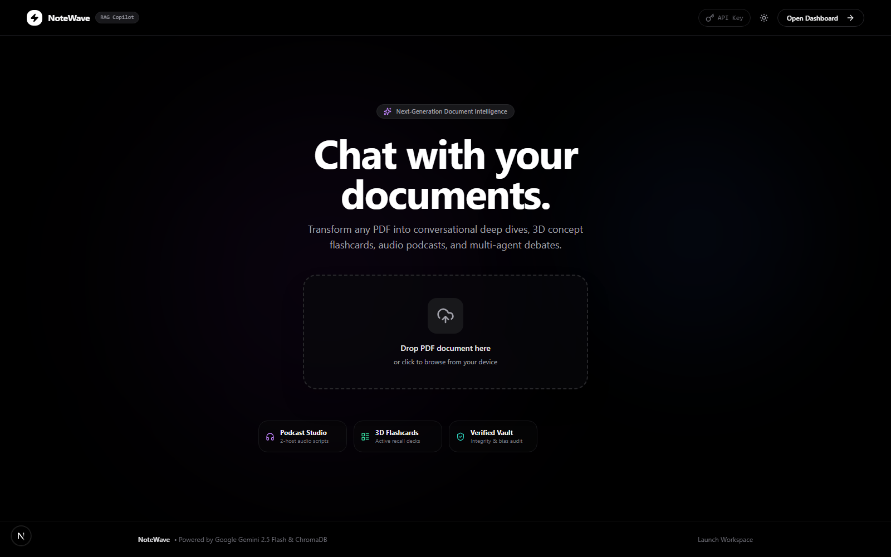

<div align="center">

# NoteWave

### AI Research Copilot & Knowledge Hub

An intelligent research workspace that transforms static documents (PDF and DOCX) into
interactive conversations, audio deep-dives, multi-agent debates, adaptive
assessments, and integrity audits — all within a focused, distraction-free interface.



</div>

---

## Overview

NoteWave is a retrieval-augmented generation (RAG) platform for document research.
It combines a hybrid retrieval engine — semantic vector search, keyword search, and
neural re-ranking — with a resilient, multi-provider language-model layer. Users can
converse with their documents, generate study material, and audit content for
accuracy and bias, with graceful degradation to a local model whenever cloud
capacity is unavailable.

> **Deployment note.** NoteWave is designed to be run locally. A public deployment is
> intended only as a portfolio demonstration: because the LLM layer relies on
> free-tier Gemini credentials, it may be rate-limited or exhaust its quota without
> notice. The application handles this transparently — it rotates across a pool of
> API keys and automatically falls back to a local Ollama model — but running it
> locally provides full control and complete data privacy.

---

## Core Capabilities

### Conversational RAG Copilot
Multi-turn document chat backed by hybrid retrieval over ChromaDB and a BM25 index,
with high-integrity grounding prompts and a live status indicator. A retrieval gate
recognises greetings and chit-chat, ensuring casual messages are answered
conversationally rather than triggering unnecessary document retrieval.

### Podcast Studio
Generates a structured, two-host audio deep-dive with Web Speech playback and a
per-line script tracker.

### Flashcard Studio
Extracts key concepts into an interactive flip-card deck for active-recall study.

### Agentic Debate
A multi-persona research arena in which three agents — *Dr. Skeptic* (Critic),
*The Weaver* (Synthesizer), and *Veritas* (Fact-Checker) — debate the central thesis
of a document.

### Verified Vault
An integrity auditor that computes a Truth Score, a Bias Index, and a provenance
signature, and flags unsupported claims.

### Quiz Studio
Produces multiple-choice assessments with real-time grading, difficulty tagging, and
mastery tracking.

### Voice Immersion
Hands-free, microphone-based querying through the Web Speech API.

### Executive Summary
A structured five-point executive synthesis with key takeaways.

---

## RAG Pipeline

NoteWave's retrieval pipeline is hybrid and multi-stage:

1. **Ingestion** — Documents are parsed (PDF via PyMuPDF/pdfplumber, DOCX via
   python-docx), cleaned of encoding artifacts and recurring headers, and split
   using a document-aware **parent-child** chunking strategy. Parents preserve full
   sections; smaller children are embedded for precise matching.
2. **Embedding** — Child chunks are embedded with Gemini
   (`models/gemini-embedding-001`, 768 dimensions).
3. **Storage** — Vectors are persisted in **ChromaDB** (HNSW cosine) alongside a
   synchronized **BM25** keyword index.
4. **Retrieval** — Queries are optionally rewritten, then retrieved through both
   semantic and keyword search. Results are combined with **Reciprocal Rank Fusion
   (RRF)** and refined by a **cross-encoder re-ranker**
   (`ms-marco-MiniLM-L-6-v2`).
5. **Expansion** — Winning child chunks are expanded to their parent sections,
   producing grounded, citation-ready evidence blocks.
6. **Generation** — The assembled context is passed to the LLM with a strict
   grounding directive, producing cited, Markdown-formatted answers.

---

## Architecture Highlights

| Component | Responsibility |
|---|---|
| `backend/ingestion.py` | Parsing, text cleaning, parent-child chunking |
| `backend/retrieval.py` | Embeddings, ChromaDB, BM25, RRF, cross-encoder re-ranking |
| `backend/llm.py` | Multi-provider LLM engine and prompt construction |
| `backend/database.py` | SQLAlchemy persistence for documents, chunks, and query logs |
| `backend/config.py` | Centralised, environment-driven settings |
| `backend/key_pool.py` | Round-robin API key pool with rate-limit detection |
| `backend/main.py` | FastAPI application, job queue, and studio endpoints |

### Reliability
- **Key rotation** across a Gemini key pool on `429` / `RESOURCE_EXHAUSTED`
  responses, with fast rotation on exhausted daily quotas and exponential backoff
  otherwise.
- **Automatic local fallback** to Ollama in `auto` mode when cloud capacity is
  unavailable.
- **Background job queue** for chat, with the UI polling a status endpoint and
  displaying live progress.
- **Constrained JSON generation** with graceful fallbacks, so no studio can fail the
  API on malformed model output.

---

## Tech Stack

- **Frontend:** Next.js 16, React 19, TypeScript, Tailwind CSS, Radix UI, framer-motion
- **Backend:** FastAPI, SQLAlchemy, ChromaDB, BM25 (`rank_bm25`), cross-encoder re-ranker
- **LLM Providers:** Google Gemini (primary), local Ollama (fallback)
- **Embeddings:** Google Gemini Embedding (`models/gemini-embedding-001`, 768-dim)
- **Voice:** Web Speech API with optional ElevenLabs text-to-speech

---

## Getting Started

### Prerequisites
- Python 3.11+
- Node.js 20+
- A Google Gemini API key (one or more)

### 1. Backend (FastAPI)

```bash
cd backend
python -m venv venv

# Windows:
venv\Scripts\activate
# macOS / Linux:
source venv/bin/activate

pip install -r requirements.txt
uvicorn main:app --reload --port 8000
```

The API is available at `http://localhost:8000` (interactive documentation at
`http://localhost:8000/docs`).

### 2. Frontend (Next.js)

```bash
cd frontend
npm install --legacy-peer-deps
npm run dev
```

The application is available at `http://localhost:3000`.

### Environment Variables (`backend/.env`)

```env
GOOGLE_API_KEYS=key1,key2,key3      # Comma-separated pool, rotated on rate limits
GOOGLE_API_KEY=your_key             # Single-key fallback
LLM_PROVIDER=auto                   # auto | gemini | ollama
OLLAMA_MODEL=qwen3:1.7b             # Local model used when Gemini is unavailable
ELEVENLABS_API_KEY=your_key         # Optional; browser TTS is used when absent
```

---

## Self-Hosting with Ollama

NoteWave supports fully private execution over a local Ollama instance, with no
cloud LLM required.

1. Download [Ollama](https://ollama.com/) and pull a model:
   ```bash
   ollama pull qwen3:1.7b
   ```
2. In `backend/.env`, set `LLM_PROVIDER=ollama` (or keep `auto` for Gemini-first
   operation with local fallback) and `OLLAMA_MODEL=qwen3:1.7b`.
3. Restart the backend. All prompts are then routed securely to the local engine at
   `http://localhost:11434`.

---

## Verification

The backend ships with an end-to-end verification suite covering text cleaning,
parent-child chunking, BM25 search, RRF fusion, cross-encoder re-ranking, query
rewriting, security sanitisation, and all studio endpoints:

```bash
cd backend
python verify_rag.py
```

---

## Project Structure

```
notewave/
├── backend/
│   ├── main.py           # FastAPI app — chat (job queue + polling), upload, studios, TTS
│   ├── config.py         # Centralised, environment-driven settings
│   ├── database.py       # SQLAlchemy layer — documents, parent chunks, query logs
│   ├── ingestion.py      # PDF/DOCX parsing, text cleaning, parent-child chunking
│   ├── retrieval.py      # Hybrid retrieval — embeddings, ChromaDB, BM25, RRF, re-ranker
│   ├── llm.py            # LLM engine (Gemini + Ollama fallback) and prompt builders
│   ├── key_pool.py       # Round-robin Gemini key pool with rate-limit detection
│   ├── tts.py            # ElevenLabs synthesis (optional)
│   ├── verify_rag.py     # End-to-end verification suite
│   ├── requirements.txt
│   ├── chroma_db/        # Persistent vector store (auto-created)
│   └── documents/        # Uploaded documents
├── frontend/
│   ├── src/
│   │   ├── app/
│   │   │   ├── globals.css          # Pitch-black theme and markdown styling
│   │   │   ├── layout.tsx           # Root layout and theme provider
│   │   │   └── page.tsx             # Landing page and three-column dashboard
│   │   ├── components/
│   │   │   ├── dashboard/           # Sidebars, command palette, studios
│   │   │   ├── landing/             # Drag-and-drop landing page
│   │   │   └── ui/                  # Radix + Tailwind UI primitives
│   │   └── lib/                     # API client, commands registry, agent profiles
│   └── next.config.ts
└── README.md
```

---

## Roadmap

- [x] Resilient LLM layer — key rotation with automatic local Ollama fallback
- [x] Live chat progress — job queue with status polling
- [x] Hybrid retrieval — BM25 + vector search with RRF and neural re-ranking
- [ ] Additional document formats (PPTX, XLSX)
- [ ] Retrieval evaluation framework (Precision@K, Recall@K, faithfulness)

---

## License

Released under the MIT License. See [LICENSE](LICENSE) for details.

---

## Acknowledgements

- **Design inspiration:** Google NotebookLM.
- **Development support:** architectural guidance and quality assurance assisted by
  Gemini-based tooling and open-source Ollama.
